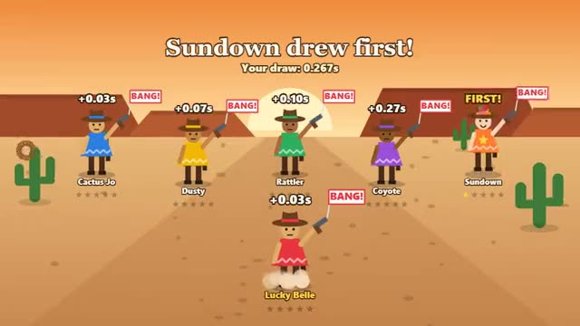

# Quick Draw

Wait for DRAW! Tap first. Flinch and you foul. A multiplayer starter game from [Multiplayer Agent](https://multiplayeragent.com): 2D, party, 2–8 players, with bots that fill empty seats.

## How it plays

Everyone stands still while the tension builds. When the sign says DRAW!, tap: the first tap to reach the host wins the round. Tap too soon and you sit the round out. First to 5 wins.

**Controls:** Click, tap anywhere or press Space.

## Make it yours in the Game Builder

Open the [Game Builder](https://multiplayeragent.com), choose **Start from a starter game** and pick Quick Draw. It opens as version 1 in your studio, ready to play and publish. Then ask for changes, for example:

- Make it a space duel with laser blasters and aliens
- Add fake-out signs like DRAT! that you must not tap on
- Make the last round worth double

## Run it yourself

1. Get a free publishable key (`pk_…`) at [multiplayeragent.com](https://multiplayeragent.com).
2. In `index.html`, put it in place of `pk_REPLACE_ME` in the `MP_CONNECT` block.
3. Open `index.html` in a browser. No build step and no server needed.

Without a key it still runs, offline against bots.

## How it is built

- One `index.html`. The comment at the top of the script maps the code and explains the multiplayer.
- **Host-run rounds:** One player's browser picks the moment and judges who drew first, in the order the taps reach it (its own tap gets there quickest); if it leaves, the next player takes over.
- **Leaderboard:** Each player's fastest reaction, timed in their own browser.
- **Bots:** Bot gunslingers draw at different speeds and sometimes flinch, until enough people join.
- `?attract` runs it offline with bots and an autopilot for you. The preview video is recorded from it.

## License

MIT.
